<p align="center">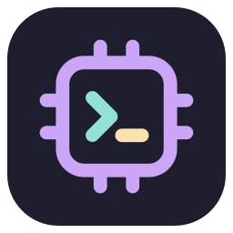</p>

# Systems & AI Academy

A terminal-based study companion for **self-learners**. It covers the core of a computer science degree plus modern AI and defensive security in **21 stages**, starting with how computers work, and it assumes no prior knowledge. Every concept is explained from scratch and comes with **real-world exercises**.

It is written in Go, uses only the standard library, and keeps all your progress in one readable JSON file.

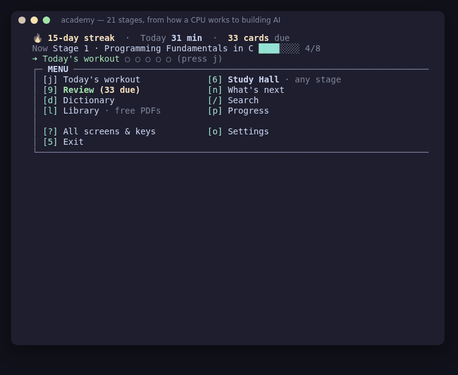

New here? Build it (below), run it, and press **`0`** for the *Start Here* guide. The path starts at **Stage 0, How Computers Work**, then **Stage 1, C**.

## Contents

- [Install](#install)
- [The curriculum](#the-curriculum)
- [How computers work (Stage 0)](#how-computers-work-stage-0)
- [C first: see what is under the hood](#c-first-see-what-is-under-the-hood)
- [How each concept is taught](#how-each-concept-is-taught)
- [Exercises](#exercises)
- [Checked exercises: your C, compiled and tested for real](#checked-exercises-your-c-compiled-and-tested-for-real)
- [Built to be remembered, not just read](#built-to-be-remembered-not-just-read)
- [Think first: learning without leaning on AI](#think-first-learning-without-leaning-on-ai)
- [Get hired: the career center](#get-hired-the-career-center)
- [Menu](#menu)
- [Study Hall](#study-hall)
- [Programmer's dictionary](#programmers-dictionary)
- [Library: PDFs without leaving the academy](#library-pdfs-without-leaving-the-academy)
- [Your own resources](#your-own-resources)
- [Tech watch: keeping up with the field](#tech-watch-keeping-up-with-the-field)
- [Classic Mode: learn like it's 1985](#classic-mode-learn-like-its-1985)
- [Accurate resources](#accurate-resources)
- [Keyboard](#keyboard)
- [Resizing the terminal](#resizing-the-terminal)
- [Colours and settings](#colours-and-settings)
- [Data safety](#data-safety)
- [Schema (abridged)](#schema-abridged)
- [Tests](#tests)
- [Source layout](#source-layout)
- [Releasing](#releasing)

## Install

### Recommended: the installer (one command)

It installs the academy like any other app, without administrator rights: the program goes where your system keeps per-user apps, `academy` works in every new terminal, and the app appears in your app menu with its icon. The installer downloads the latest release from this repository and checks its SHA256 checksum before installing anything.

**Windows** (PowerShell):

```powershell
irm https://raw.githubusercontent.com/pronexuscodex/learning_space/main/install.ps1 | iex
```

This adds **Systems & AI Academy** to the Start Menu and to **Settings → Apps → Installed apps**, where you can uninstall it like any other app.

**macOS and Linux** (Terminal):

```sh
curl -fsSL https://raw.githubusercontent.com/pronexuscodex/learning_space/main/install.sh | sh
```

On macOS, **Academy** appears in Launchpad and Spotlight and can be kept in the Dock. On Linux, **Systems & AI Academy** is added to your applications menu. Both open in a terminal window.

| | Windows | macOS and Linux |
|---|---|---|
| Program | `%LocalAppData%\Programs\Academy\academy.exe` | `~/.local/bin/academy` |
| Your progress and backups | `%LocalAppData%\academy` | `~/Library/Application Support/academy` (macOS), `~/.local/share/academy` (Linux) |
| Your PDFs | `Documents\Academy Library` | `Documents/Academy Library` |

To **upgrade**, run the same command again: your progress and PDFs are never touched. `academy -where` shows exactly where everything is. To **uninstall**, use Settings → Apps on Windows, or run `curl -fsSL https://raw.githubusercontent.com/pronexuscodex/learning_space/main/install.sh | sh -s -- --uninstall` on macOS and Linux. Uninstalling keeps your progress and PDFs, and lists where they are in case you want to delete them too.

Installed this way, the program never shows the "unknown developer" or SmartScreen warnings that downloaded files get. To install a specific version, set `ACADEMY_VERSION=v1.2.0` first.

### With a package manager (from version 1.1.0)

**macOS and Linux, with [Homebrew](https://brew.sh):**

```sh
brew tap pronexuscodex/academy https://github.com/pronexuscodex/learning_space
brew install pronexuscodex/academy/academy
```

**Windows, with [Scoop](https://scoop.sh):**

```powershell
scoop bucket add academy https://github.com/pronexuscodex/learning_space
scoop install academy/academy
```

Then run `academy`. Update later with `brew upgrade academy` or `scoop update academy`. Package-manager installs usually avoid the unknown-developer warnings described below, and they keep your progress in a per-user folder that upgrades never touch (see [Where your progress lives](#where-your-progress-lives)).

### Download a release (no Go needed)

1. Download the archive for your system from the [Releases page](https://github.com/pronexuscodex/learning_space/releases):

   | System | File |
   |--------|------|
   | Linux (most PCs) | `academy-vX.Y.Z-linux-amd64.tar.gz` |
   | Linux (Raspberry Pi 4/5, ARM servers) | `academy-vX.Y.Z-linux-arm64.tar.gz` |
   | macOS (Apple silicon: M1 and later) | `academy-vX.Y.Z-darwin-arm64.tar.gz` |
   | macOS (Intel) | `academy-vX.Y.Z-darwin-amd64.tar.gz` |
   | Windows (most PCs) | `academy-vX.Y.Z-windows-amd64.zip` |
   | Windows on ARM | `academy-vX.Y.Z-windows-arm64.zip` |
   | FreeBSD | `academy-vX.Y.Z-freebsd-amd64.tar.gz` |

2. Optionally check that the download is intact against `SHA256SUMS`:

   ```sh
   sha256sum -c SHA256SUMS --ignore-missing           # Linux
   shasum -a 256 -c SHA256SUMS --ignore-missing       # macOS
   ```

   On Windows, run `Get-FileHash academy-*.zip` in PowerShell and compare the result with the line in `SHA256SUMS`.

   From version 1.1.0 you can also check who built it. Every archive has a signed build-provenance attestation, which proves that the release workflow built it from this repository's code:

   ```sh
   gh attestation verify academy-v1.1.0-linux-amd64.tar.gz --repo pronexuscodex/learning_space
   ```

3. Unpack it and run it from a terminal:

   ```sh
   tar -xzf academy-*-linux-amd64.tar.gz
   cd academy-*-linux-amd64
   ./academy
   ```

   On Windows, unzip it, open the folder, and run `academy.exe` from Windows Terminal or PowerShell.

The executables are not code-signed, so the first launch may show a warning:
- **macOS** says it "cannot verify the developer". Either right-click the file in Finder, choose **Open**, and confirm, or run `xattr -d com.apple.quarantine ./academy` once.
- **Windows** SmartScreen may say it "protected your PC". Choose **More info**, then **Run anyway**.

Everything runs locally and offline, apart from the optional Library downloads, tech-watch headlines and `-check-links`. Nothing is sent anywhere.

### Build from source

```sh
cd academy
go build -trimpath -ldflags="-s -w" -o academy .      # Linux / macOS
go build -trimpath -ldflags="-s -w" -o academy.exe .  # Windows
./academy
```

It needs Go 1.22 or later, and nothing else: there are no dependencies to download. Run `./academy -version` to see what you have, and `./academy -h` for every flag.

### Where your progress lives

Your progress is one file, `academy_campus_registry.json`. Backups and exports go in the same folder; downloaded PDFs go in your Documents folder (see [Library](#library-pdfs-without-leaving-the-academy)). The program creates the file on first run, in this folder:

| How you run it | Folder |
|---|---|
| `-registry path/to/file.json` | the folder of that file |
| `ACADEMY_HOME` is set | `$ACADEMY_HOME` |
| Installed with Homebrew on macOS | `~/Library/Application Support/academy` |
| Installed with Homebrew on Linux | `~/.local/share/academy` (or `$XDG_DATA_HOME/academy`) |
| Installed with Scoop or winget | `%LocalAppData%\academy` |
| Installed with the installer, or in a system folder such as `/usr/local/bin` or `Program Files` | the same per-user folder as above for your system |
| A downloaded or self-built binary anywhere else | next to the binary (a portable copy, for example on a USB stick) |
| `go run .` | the current directory, because the temporary build folder would be deleted |

Installers and package managers replace their install folder on every upgrade, which is why those installs keep your data elsewhere. If an older version left a registry beside an installed binary, it keeps being used. Run `academy -where` to see which folders are in use. To move from a downloaded copy to a package-manager install, move your registry and its folders into the new location, or set `ACADEMY_HOME` to the old folder.

Other flags:
- `-no-color`;
- `-check-links`: verify every resource URL;
- `-backups`: list automatic backups;
- `-restore N`: restore one;
- `-fetch-library`: download every PDF in the Library for offline study;
- `-check ID`: compile and test a checked exercise; `-check list` shows them all.

Checked-exercise files live in `Documents/Academy Labs` (`$ACADEMY_LABS` chooses another folder; with `$ACADEMY_HOME` set, they sit inside it).

**Upgrading from the 7-stage version:** your existing registry file is migrated automatically. The original stages move to their new numbers (1→5, 2→6, 3→7, 4→8, 5→13, 6→15, 7→16), your labs, hours, readings and concept progress are kept, and the nine new stages are added. The upgraded file is saved at once, after a backup of the old one.

## The curriculum

| Track | Stage | Topic |
|-------|-------|-------|
| **F · Foundations** | 0 | **How Computers Work**: the whole machine, before any code |
| | 1 | Programming Fundamentals **in C** |
| | 2 | Data Structures & Algorithms |
| | 3 | Discrete Mathematics, Logic & Probability |
| | 4 | Digital Logic & Computer Architecture |
| **A · Systems** | 5 | The Iron Layer: compilers & the machine |
| | 6 | Operating Systems Internals & Memory |
| | 7 | Storage Engines, Databases & SQL |
| | 8 | Networks, the Web & Distributed Systems |
| **S · Software, Security & Theory** | 9 | Software Engineering & Professional Tools |
| | 10 | Security & Cryptography: attacks, defences and incident response |
| | 11 | Theory of Computation & Complexity |
| | 12 | Programming Languages & Paradigms |
| **B · AI** | 13 | Mathematical Foundations: linear algebra & matrix calculus |
| | 14 | Probability, Statistics & Classical ML |
| | 15 | Neural Networks & Autograd from Scratch |
| | 16 | AI Infrastructure, CUDA & Inference |
| **D · Defensive Security** | 17 | Secure Coding & Code Review |
| | 18 | Identity, Access & Cloud Security |
| | 19 | Network Defence & Monitoring |
| | 20 | Incident Response, Forensics & Privacy |

That is **158 concepts** and **474 exercises**, plus a glossary, a resource library, lab blueprints, a quiz and a mastery check for every stage. Start Here also lists electives for afterwards: graphics, quantum computing, embedded systems and bioinformatics.

## How computers work (Stage 0)

The academy starts before programming, with a guided tour of the whole machine, so that everything later has somewhere to fit. Stage 0's eight concepts:

1. **Bits & Bytes: Everything Is a Number**: binary, hex, and how text, colours, images, sound and programs are all numbers.
2. **The CPU at Work: Fetch, Decode, Execute**: registers, the ALU, the program counter, the clock, and instruction sets (x86-64, ARM64, RISC-V).
3. **Memory & Storage: Where Data Lives**: RAM versus storage, and the memory hierarchy with real latencies (if an L1 cache hit took a second, a RAM read would take a minute and a half, and a transatlantic round trip about three years).
4. **From Source Code to Running Program**: compilers, executables (ELF, PE, Mach-O), processes, the loader, and system calls, seen with `strace`.
5. **The Operating System: The Machine's Manager**: user and kernel mode, scheduling, virtual memory, files and drivers.
6. **Input & Output: Keys, Screens & Interrupts**: a keypress followed from the key switch to the pixel, plus interrupts, polling and DMA.
7. **Networks: How Computers Talk**: packets, layers, and what happens when you open a web page (DNS, TCP, TLS, HTTP).
8. **Booting: From Power Button to Login**: firmware, boot loader, kernel, process 1, services.

Each concept has the usual analogy, real-life example, diagram and three exercises, plus an **🔧 Under the hood** section with the real bytes and commands. The Classic corner pairs Petzold's *Code* with Shannon's 1948 paper that defined the bit, and the LC-3 virtual machine tutorial. The type-in is a **tiny CPU simulated in C**: you predict what it prints and trace its fetch–decode–execute steps by hand. *Computer Science from the Bottom Up* is in the Library as a free PDF.

Stage 1 (C) builds on it, so a fresh campus starts at Stage 0.

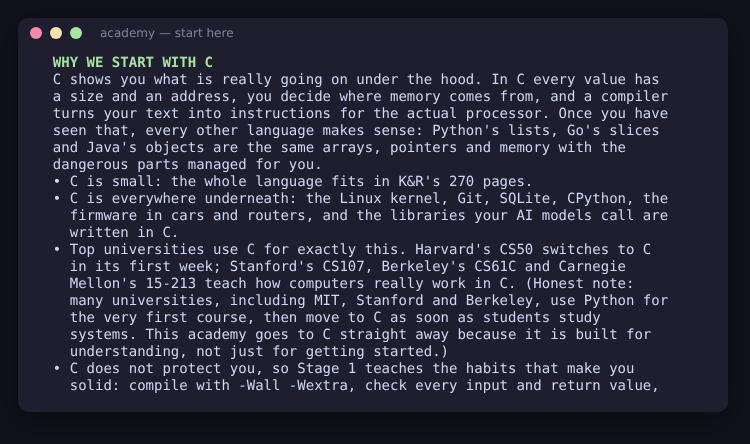

## C first: see what is under the hood

Stage 1 teaches programming **in C**. In C, every value has a size and an address, and the compiler turns your text into real machine instructions, so from the first week you see what other languages do for you behind the scenes. Stage 1 has twelve concepts, each with a checked exercise you write and the academy compiles and tests (see below), and ends with a project:

1. Your First C Program: Source, Compiler, Executable (including installing gcc or clang, on Linux, macOS, or Windows via WSL)
2. Values, Types & Variables (sizes, integer division, casts, printf formats)
3. Control Flow: Decisions & Loops
4. Functions & Decomposition (prototypes, pass-by-value, the stack)
5. Memory, Addresses & Pointers
6. Collections: arrays, and strings with their '\0'
7. Structs: fields, `.` and `->`, passing structs, padding and alignment
8. Dynamic Memory: malloc, calloc, realloc and free; ownership; leaks, double frees and use-after-free; the growable array
9. Safe Input & Undefined Behavior: fgets and strtol, checking return values, and -fsanitize=address,undefined
10. Files & Streams: fopen and its modes, fgets, fgetc and fread, perror, buffering and fclose
11. Headers, the Preprocessor & make: separate compilation, include guards, static, the linker's symbols, macros, Makefiles
12. Debugging & Reading Errors: compiler warnings, gdb, sanitizers

Every Stage 1 concept also has an **🔧 Under the hood** section showing what the machine really does, taken from real gcc output on x86-64:
- `int count = 3;` as a stack slot, and its little-endian bytes;
- a loop as compare-and-jump, and an `if` turned into a conditional move;
- the calling convention (arguments in `rdi` and `rsi`, the result in `eax`);
- `*p` as a single load, and `a[i]` as `[a + i*4]`;
- struct padding, and a field access as one load at a fixed offset;
- malloc as library code over brk and mmap, and why heap bugs crash far away;
- a FILE as a file descriptor plus a buffer: about 260 `read` calls for a 1 MB file;
- `nm` showing the T and U symbols the linker matches, and a macro that computes 5 for SQUARE(1+2);
- the path from `_start` through `__libc_start_main` to `main`, and printf as one `write` system call;
- gcc -O2 deleting an overflow check that relies on undefined behaviour;
- how gdb plants an `int3` breakpoint.

Every exercise is in C. The reading list is K&R, King's *C Programming: A Modern Approach* and Gustedt's free *Modern C*, with *Beej's Guide to C* downloadable in the Library. The Classic corner pairs K&R with antirez's kilo editor and a C type-in.

Why C: it is small, it is what the operating system, databases, language runtimes and firmware underneath everything are written in, and strong universities teach systems in it. Harvard's CS50 switches to C in its first week, and Stanford's CS107, Berkeley's CS61C and CMU's 15-213 teach systems in C. (Many universities start with Python for the very first course and then move to C; the academy goes straight to C for understanding.) C also lets you make mistakes other languages hide, so Stage 1 teaches the defensive habits from day one.

**Existing registries** are updated on load: Stage 1's title changes, the C books are added to its reading list (books you already marked read are kept), and all concept progress, notes and reviews stay as they were. The five original concept names are unchanged, so nothing is lost.

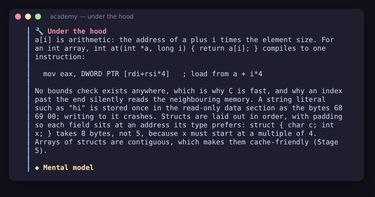

## How each concept is taught

Each concept moves from intuition to precision:

1. **💬 In plain words:** an everyday analogy with no jargon.
2. **🌍 Real life:** where you have already met the idea, such as the Ariane 5 overflow, GTA Online's quadratic loading screen, Kubernetes running on Raft, or the CrowdStrike outage.
3. **🔍 The details:** the precise technical explanation, with a diagram where one helps. Code in explanations keeps its layout.
4. **🔧 Under the hood:** (Stages 0 and 1) what the machine really does: the bytes, the instructions, the system calls.
5. **◆ Mental model:** one sentence to remember.
6. **🏋 Exercises:** three per concept, from easy to real-world (see below).
7. **🔗 Connects to / 📚 Go deeper:** related concepts in other stages, and exactly where to read next.
8. **📝 In your own words:** your explanation, once you have written it.
9. **📖 Words to know / 🔤 Programmer words here:** the stage glossary and dictionary entries for any jargon in the card, listed automatically at the bottom.

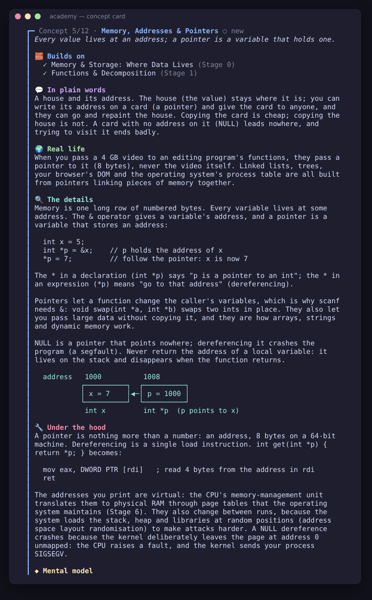

## Exercises

Every concept has a ladder of three exercises, and each exercise has a hint:

| Level | What it is | Example (Hash Tables) |
|-------|------------|------------------------|
| ● **Warm-up** | Pen and paper; no code needed | Hash "cat", "act" and "dog" into 5 buckets by hand; why do two of them collide? |
| ● **Practice** | A small program | Build a word counter on your own hash table and race it against the built-in one on a full book |
| ● **Real-world** | A task from a real situation | Find duplicate sign-ups among 1 million shop accounts in roughly O(n) |

The **Exercise Gym** in each stage's Study Hall shows the exercises, reveals hints only when you ask, and lets you tick exercises off. Your progress is saved (`exercises_done`) and shown in the ledger, and it counts towards overall campus progress.

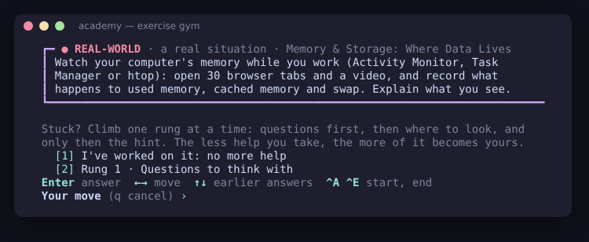

## Checked exercises: your C, compiled and tested for real

Ticking an exercise off says you did it; a checked exercise shows it. Stage 1 has twelve, one for each concept, and a project that joins them:

| Check | Concept | What the tests catch |
|-------|---------|----------------------|
| `hello` | Your first C program | the exact greeting and a clean exit |
| `types` | Values and types | your predictions: integer division, `%`, casts, characters as numbers, `sizeof` |
| `fizzbuzz` | Control flow | the order of the tests, and loop bounds |
| `temperature` | Functions | integer division (9 / 5 is 1), and that the two functions are inverses. The checker supplies `main` and calls your functions |
| `swap` | Pointers | swapping copies instead of the originals, and the XOR trick that zeroes a variable swapped with itself |
| `letters` | Arrays and strings | case, non-ASCII bytes, and 200,000 characters of input (no fixed-size buffer) |
| `scores` | Structs | ties (the first wins), an empty input, a 31-letter name in a 32-byte field, a floating-point average |
| `intvec` | Dynamic memory | a growable array (`vec_push` doubling with `realloc`), a million pushes, and the **leak checker**: memory never freed fails the check |
| `safe_number` | Safe input | `fgets` and `strtol` used properly: `12abc`, empty input, end of input, and numbers that overflow `int` or even `long` |
| `count` | Files | a `wc` of your own: test files given to the program, no final newline, zero bytes in the file, a missing file (perror, exit 1) and no argument (exit 2) |
| `stack` | Headers and make | two files you write, `stack.h` and `stack.c`. The checker's `main` includes the header twice, so it needs an include guard; it also tests a full and an empty stack, and two stacks at once |
| `fix_average` | Debugging | a program with two bugs: the sanitizer finds one, the wrong output the other |
| `wordfreq` | **Stage 1 project** | the ten most frequent words of any text: case, ties in alphabetical order, a 5,000-letter word, 200,000 words, empty input, and no leaks |

**How it works.**
1. Open one from the Study Hall (**Checked exercises**). The academy creates your file in `Documents/Academy Labs/Stage 01/` with a short comment saying what to write. It never overwrites the file afterwards.
2. Write the program in any editor and save it.
3. Run the check from the same screen, or from another terminal with `academy -check fizzbuzz` (`academy -check list` shows them all).

**What a run does.**
- It compiles your file with the C compiler on your computer (`$CC`, `cc`, `gcc` or `clang`): `-std=c17 -Wall -Wextra -Werror`, so warnings are errors.
- Where your compiler supports them, AddressSanitizer and UndefinedBehaviorSanitizer are switched on. A read past the end of an array is then reported as one, with the function and line.
- It runs the program on each test case. For every failure it says what was wrong ("line 15 should be "FizzBuzz", but was "Fizz"", "main returned 0, expected 1", "did not finish within 2s") and the usual cause.
- Hints are revealed one at a time. None contains the solution.

The later stages have checked exercises too, written with C and POSIX only, so they behave the same on Linux, macOS and the BSDs:

| Check | Stage and concept | What the tests catch |
|-------|-------------------|----------------------|
| `linkedlist` | 2: Linked lists | push, reverse by relinking (a recursive reverse runs out of stack on a million nodes), empty lists, and every node freed |
| `hashmap` | 2: Hash tables | string keys copied, replacing, removing, colliding keys, a table that must grow for 100,000 keys, and no leaks |
| `heap_sort` | 2: Heaps & sorting | an in-place heap sort: edge cases, sorted and reversed input, and a million numbers in the time limit (a quadratic sort cannot) |
| `bfs` | 2: Graphs | the shortest path through a maze of up to 1000 × 1000: steps not cells, no path, the shortest rather than the first found |
| `duplicates` | 2: Big-O | the first repeated number among 200,000: nested loops (O(n²)) run out of time, and a comparison written as `a - b` overflows |
| `hanoi` | 2: Recursion | the Towers of Hanoi: every one of the 65,535 moves for 16 disks, and 0 disks |
| `bsearch` | 2: Binary search | the first match among repeats, empty arrays, and 100,000 lookups in 200,000 numbers (a linear scan runs out of time) |
| `intervals` | 2: Greedy algorithms | the most meetings in one room: back-to-back meetings, and the greedy rules that look right and fail (by start time, by length) |
| `edit_distance` | 2: Dynamic programming | empty lines, sentences, and two 2,000-character lines (the plain recursion is exponential) |
| `sat_count` | 3: Logic | rows of a truth table over 16 variables: variables numbered from 1, empty clauses, contradictions |
| `bitsets` | 3: Sets | sets as `uint64_t` bits: union, intersection, differences, subsets, the empty set, and members 31 to 63 (`1 << i` is an int) |
| `binomial` | 3: Counting | C(n, k) exactly up to C(67, 33): the factorial formula fails from 21!, and multiplying before dividing overflows |
| `modpow` | 3: Modular arithmetic | aᵉ mod m with e up to 10¹⁸ (square and multiply), m = 1, and a bigger than m |
| `inversions` | 3: Recurrences | inversions in 200,000 numbers with merge sort: ties, and counts above 2³¹ |
| `euler` | 3: Graph theory | circuit, path or none: Königsberg, two separate triangles (degrees alone are not enough), lonely vertices, a ring of 100,000 |
| `birthday` | 3: Probability | the exact birthday probability: integer division, and more than 365 people |
| `bases` | 4: Binary | decimal, hex and binary in and out, 0, and 4,294,967,295 (which an `int` prints as -1) |
| `nand_gates` | 4: Logic gates | NOT, AND, OR and XOR from NAND with the fewest gates (the checker counts them), and an 8-bit ripple-carry adder |
| `alu` | 4: The ALU | the zero, negative, carry and overflow flags for addition, subtraction and logic, against a million random operations |
| `number_fsm` | 4: State machines | valid decimal numbers: `5.` and `.5` but not `.`, exponents that need digits, spaces, and 400 generated lines |
| `cpu` | 4: The CPU | an emulator for a tiny CPU: jumps by instruction number, 64-bit registers, and a step limit for endless loops |
| `rv_decode` | 4: Machine code | real RISC-V machine code (from LLVM's assembler): sign-extended immediates, add vs sub in bit 30, and unknown words |
| `bits` | 5: Integers & floating point in bits | popcount, rotating by 0 (a shift by 32 is undefined), powers of two, and the raw IEEE 754 fields of 1.0, -2.5, 0.1 and -0.0 |
| `calc` | 5: Parsing | a recursive-descent calculator: precedence, left-to-right order (10 - 4 - 3 is 3), unary minus, truncating division, malformed lines, division by zero, 500 levels of parentheses |
| `linkage` | 5: Linking | three functions linked with the checker's own file, which already defines `count` and `total`: a global of yours clashes at link time (built with `-fno-common` everywhere) |
| `checked_add` | 5: The optimizer | overflow checks for `+` and `*` that never overflow themselves: `INT_MIN * -1`, checks written after the overflow (the sanitizer stops them), a million random pairs |
| `run` | 6: Processes | fork, execvp and waitpid: exit codes, death by a signal, arguments passed on, a program that does not exist (127) |
| `rawcopy` | 6: System calls | a copy with `read` and `write` only: short writes, and half a megabyte of every byte value |
| `counter` | 6: Synchronisation | threads sharing a counter: without a mutex, increments are lost |
| `arena` | 6: Memory allocators | a bump allocator: 16-byte alignment, failed requests that use no space, `used + n` wrapping past `SIZE_MAX`, a million nodes, and the block freed |
| `pipeline` | 6: File descriptors & pipes | `A \| B` with pipe, dup2, fork and execvp: a forgotten close (cat waits forever), more than the pipe's 64 KiB, `yes \| head`, B's exit status |
| `graceful` | 6: Signals | SIGTERM and SIGINT recorded by a handler: sent by the program itself and by another process, and a blocking read interrupted (SA_RESTART must be off) |
| `atomic_save` | 7: Durability | a temporary file in the same folder, fsync, rename, fsync the folder: exact bytes, nothing left behind, failure leaves nothing |
| `wal_kv` | 7: Write-ahead logging | a key-value store that appends every change to `data.log` before answering, replays it at start, and cuts off a record torn by a crash (the checker reads the log afterwards) |
| `buffer_pool` | 7: Pages & the buffer pool | LRU eviction with pins and dirty write-backs, frames that are all pinned, a scan that floods LRU, and a million accesses |
| `bloom` | 7: LSM-trees | a Bloom filter: no false negatives, under 1.5% false positives at 10 bits per key, and 1,001 bits (`m / 8` bytes is one short) |
| `hash_join` | 7: Query planning | a join of two 100,000-row tables (a nested loop runs out of time), duplicate keys on both sides in order, and negative keys (a negative bucket index) |
| `upper_server` | 8: Sockets | a TCP server on a real 127.0.0.1 socket: partial reads of 300 KB, a client that sends nothing, bytes above 127 |
| `routes` | 8: IP routing | longest-prefix match: the default route, /32 and /0 (a shift by 32 is undefined), host bits in a prefix, and 100,000 routes |
| `retry` | 8: Timeouts & retries | backoff with jitter: permanent failures not retried, no wait after the last attempt, the cap, and 70 attempts (doubling a `long` overflows) |
| `ring` | 8: Consistent hashing | keys placed on a ring of virtual nodes: wrapping past the largest point, and 100,000 points searched in sorted order |
| `git_blob` | 9: Git | SHA-1 written by hand, matching `git hash-object`: the empty file, the 55-, 56- and 64-byte padding boundaries, a three-digit length, and 2 MB of every byte value |
| `make_order` | 9: Build systems | the order make builds in: depth-first, each target once, cycles (exit 1), a missing rule (exit 2), and 100,000 rules |
| `bisect` | 9: Debugging tools | git bisect as a function: at most ⌈log₂ n⌉ tests, never the known ends, and a midpoint that cannot overflow near `LONG_MAX` |
| `cvss` | 10: Reading CVEs | a CVSS v3.1 base-score calculator: scope-dependent weights, round-up (not round-to-nearest), zero-impact vectors, and thousands of combinations against the official formula |
| `nfa_match` | 11: Regex engines | a regex engine that never backtracks: precedence, whole-line matches, `(a+)+b` on 30 a's, 100,000-character lines, invalid patterns |
| `turing` | 11: Turing machines | a Turing-machine simulator: the move into H counts, the 1s left on the tape, step limits, and the 5-state busy beaver's 47,176,870 steps |
| `dpll` | 11: Reductions | a SAT solver for DIMACS CNF: clauses across lines, pigeonholes (UNSAT), and the Inkala Sudoku as 11,988 clauses |
| `higher_order` | 12: Closures & higher-order functions | map, filter and fold with a `void *` context, C's closures: the context passed on, left-to-right folds, empty arrays |
| `refcount` | 12: Memory management | reference-counted strings: shared holders, a copy of the text, no use after free, and nothing leaked |
| `stack_vm` | 12: Interpreters | a bytecode VM: operand order, loops with JZ, 90 million instructions, and programs refused before they run |
| `softmax` | 13: Softmax & cross-entropy | softmax and cross-entropy for logits of ±1000: subtracting the maximum, the loss from log-sum-exp (800, not infinity), classes counted from 0 |
| `power_iter` | 13: Eigenvectors | the largest eigenvalue and its eigenvector by power iteration: negative eigenvalues, a start on the wrong eigenvector, slow convergence, a 300 × 300 matrix |
| `kahan_sum` | 13: Floating point | plain, Kahan and double sums of up to 100 million floats: 0.1 ten million times, absorption above 2²⁴, and the cancellation Kahan cannot save |
| `safe_join` | 17: Untrusted input | canonicalise, then check: `a/./b//c.txt` is fine, `a/../../etc/passwd` and `/etc/passwd` are refused, and the output buffer is never overrun |
| `copy_string` | 17: Memory-safe code | an strlcpy of your own: always terminated, never past the buffer, size 0, and the full length returned |
| `http_request` | 8: HTTP | parsing a request head: header names in any case, trimmed values, bare newlines, a 7,000-byte path, a missing Host, wrong versions, a head that never ends |

**What's next** suggests a check as soon as you mark its concept as understood: you've read it, now make it work. It suggests the project once the whole stage is understood.

**Evidence.** Every run and every hint is appended to `academy_checks.jsonl`, beside your progress. Each run line records the time, the compiler, the cases passed, whether the sanitizers were on, and how many hints you had seen. The academy shows a check as **passed on your own** (no hints), **passed, with hints**, the cases passing in the latest run, or **does not compile yet**. A concept with a checked exercise reaches **mastered** only once that check has passed: understanding, practice and spaced reviews are not enough on their own. Concept cards show the check for their concept.

**Safety.**
- Your program is your own code, run on your own computer.
- Each run gets:
  - a fresh temporary folder;
  - an environment with none of your variables, so no tokens or keys;
  - a 2-second limit per case, after which its whole process group is killed;
  - a 1 MB output cap.
- This is not a sandbox: like any program you compile yourself, it could still touch your files or the network.
- The academy never runs code from anywhere else.

**Platforms.** Checked exercises need Linux, macOS or a BSD. On Windows, install WSL and run the academy there.

## Built to be remembered, not just read

Reading something once is not learning it. The academy builds in five techniques that research on memory consistently supports:

| Technique | How the academy uses it |
|-----------|-------------------------|
| **Retrieval practice** | **Daily Review** (menu `9`) asks questions instead of showing answers. You try to answer, reveal, then grade yourself: forgot / hard / good / easy. |
| **Spaced repetition** | Each card is rescheduled with an SM-2 style algorithm: 1 day, then 3 days, then roughly a week, then weeks and months. Forgotten cards return in the same session and restart their interval. |
| **Interleaving** | Reviews and mastery checks shuffle cards across concepts and stages. |
| **Your own words** (the Feynman technique) | Marking a concept as understood asks you to explain it in your own words. Your explanation is shown back to you on the concept card and next to its key-idea review card. |
| **Elaboration & connections** | Every concept links to related concepts in other stages, and every stage shows what it builds on. |

Each understood concept adds **three review cards** to your deck: its key idea, a real-life example, and its warm-up exercise. Once half of a stage's concepts are understood, the stage's quiz questions join the deck too. All answers come straight from the curriculum.

**The mastery ladder:** each concept climbs ○ new → ◔ understood → ◑ practised (2 exercises) → ◕ retained (every card remembered at a spacing of 7+ days) → ● **mastered** (all 3 exercises done, every card remembered at a spacing of 21+ days, and the concept's [checked exercise](#checked-exercises-your-c-compiled-and-tested-for-real) passed, where it has one). "Mastered" cannot be reached in a single day; it measures what you still know weeks later. Campus progress is weighted by mastery.

**The Mastery Check:** each stage has a 12-question interleaved exam drawn from all of its cards, and you pass at 80%. The result is recorded, and graduating a stage warns you if you have not passed it.

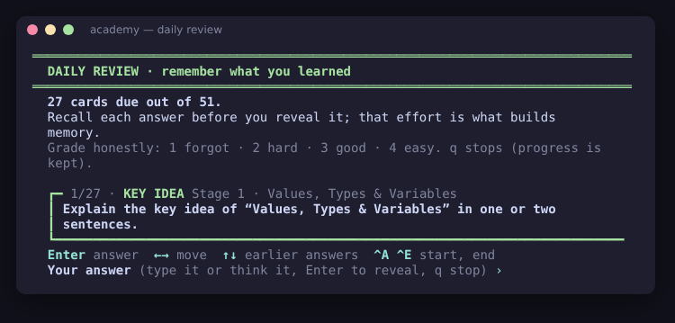

## Think first: learning without leaning on AI

An AI can write the answer in seconds, which is exactly why it can stop you from learning: the effort of working something out is what builds understanding. In a field experiment with high-school maths students, those given an unrestricted AI assistant did better during practice but worse on the exam once it was taken away; a version that gave hints instead of answers avoided most of that harm ([Bastani et al., PNAS 2025](https://doi.org/10.1073/pnas.2422633122)). Researchers call handing your thinking to a tool *cognitive offloading* ([Risko & Gilbert, 2016](https://doi.org/10.1016/j.tics.2016.07.002)).

The academy's rule, in order: **think first, look it up second, ask an AI last**, and then only to check your own answer. Five features help you keep it:

| Feature | What it does | Why it works |
|---|---|---|
| **Today's workout** (`j`) | One guided session a day, about 30 to 45 minutes: warm-up review, blank-page recall, one new concept, a mixed exercise and a short reflection. Each step is saved, so you can stop and resume. The dashboard shows today's progress. | Strings the best-supported techniques together, in the order that works, every day. |
| **The hint ladder** | When you are stuck: rung 1 asks the questions an engineer asks (what is asked, the smallest case, explain it to a rubber duck); rung 2 says where to look it up (your concept card, the glossary words in the task, the reading pointer, man pages and specs); only rung 3 shows the hint. In Classic Mode the hint stays behind the struggle clock. | Being stuck for a while is a *desirable difficulty* (Bjork); looking it up in primary sources is the engineer's core skill. |
| **Honest solve log** | After each exercise you say how you got there: on your own, with the docs, with the hint, or with an AI or someone else's answer. Anything solved with the hint or with help comes back three days later, to redo from a blank page. | Only what you can do alone is yours; the redo turns a borrowed answer into real retrieval. |
| **Blank-page recall** | Write everything you remember about a concept, then compare with the card and score yourself. Weak recalls come back the next day, strong ones weeks later. | Free recall is among the most effective study techniques; rereading mostly creates a feeling of knowing ([Dunlosky et al., 2013](https://doi.org/10.1177/1529100612453266)). |
| **Calibration** | In reviews you say how sure you are (guessing, fairly sure, certain) before the answer appears. The Progress report shows how often each level is right, and tells you if you are over- or underconfident. | Knowing what you don't know (metacognition) decides what you study next. |

The **Progress report** (`p`) has a *Thinking for yourself* section: how many exercises you solved yourself, your redo list, your recalls, calibration and workouts. The share card shows *Solved myself* too, and five new achievements reward the habits: First Principles, Blank Page, Made It Mine, In Training and Know What You Know.

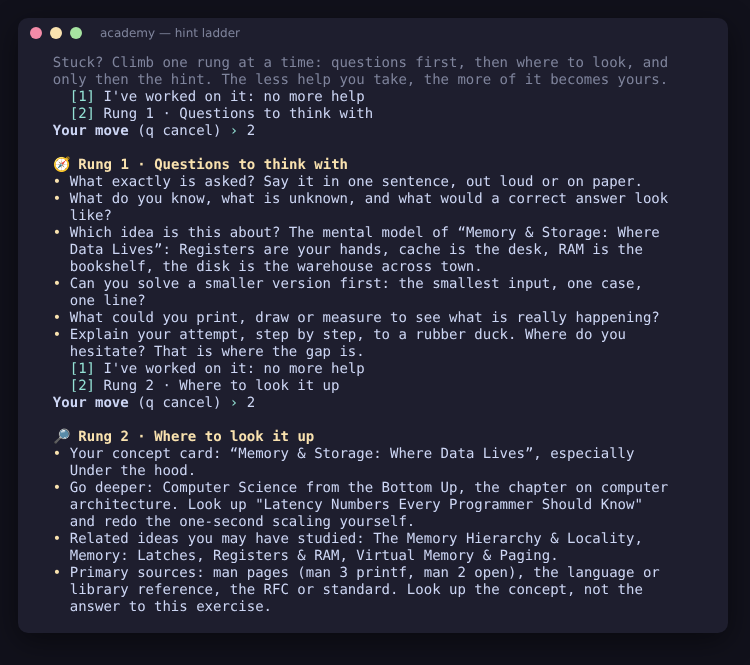

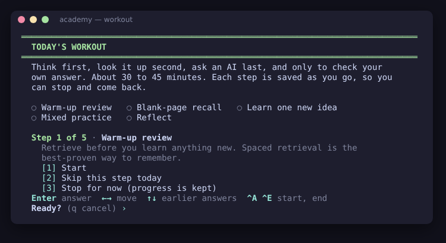

## Get hired: the career center

Press **`e`**. Companies hire engineers who can show three things: solid foundations, projects they built and finished, and that they can solve problems out loud in an interview. The career center turns your learning into all three, and tells you honestly how close you are. No app can promise a job; this one measures what interviews and hiring managers check.

- **Target roles:** Backend Software Engineer, Systems / Infrastructure Engineer, Site Reliability / Platform Engineer, Security Engineer, and Machine Learning / AI Engineer. Each explains:
  - the work, day to day, and who hires for it;
  - the job titles to search for, and a typical interview process;
  - what the interviews test;
  - the academy stages that prepare you (with your progress in each);
  - the portfolio projects employers value, and the skills to put on your resume;
  - role-specific advice.
- **Readiness report:** a score made of four parts, the weakest first, with concrete next steps:
  - *foundations* (40%): concepts understood in the role's stages;
  - *portfolio* (25%): projects shipped with tests passing, three to aim for;
  - *interview practice* (20%): coding mocks, system design mocks and stories;
  - *job-search kit* (15%).
- **Portfolio projects:** each role's projects are lab blueprints from the curriculum. Start one with a keystroke, then log hours and mark its tests passing as usual. A checklist covers what makes a project count with employers: README, one-command run, tests in CI, design notes, results, and what you learned.
- **Coding interview patterns:** an eight-step method to use on every problem (understand, examples, brute force, optimise, plan, code, test, analyse). Then 16 patterns, among them hash maps, two pointers, sliding window, prefix sums, binary search on the answer, intervals, monotonic stacks, BFS/DFS, topological order, union-find, heaps, backtracking, dynamic programming and tries. Each has the signals that point to it, the idea, the pitfalls and two practice problems written for the academy. In the think-first spirit there are no model answers: three hints, a question first, then a direction, then the key idea. After each problem you score yourself against a rubric.
- **System design:** a seven-step framework with timings, the building blocks (caches, queues, sharding, replication, consistent hashing…) and numbers every engineer should know. Then 9 classic questions (URL shortener, rate limiter, chat, news feed, distributed key-value store, file sync, notifications, web crawler, metrics pipeline), each with the questions to ask, what a strong design covers, the likely deep dives and the usual mistake.
- **Behavioral interviews:** the STAR method and the 12 questions every loop asks, with what interviewers look for. You write your own stories into a story bank, which shows which questions you can already answer.
- **Mock interviews:** timed coding (pattern hidden), system design (45 minutes) and behavioral rounds, each scored against a short rubric and kept in your history.
- **Resume builder:** the rules that get interviews, weak and strong example bullets, and a bullet written for each of your labs using the formula *what you built + how + the result*.
- **Job search:**
  - a seven-item kit (resume, GitHub profile, professional profile, a 60-second introduction, target companies, a technical write-up, references);
  - an applications tracker with stages and a response rate;
  - tips on referrals, follow-ups, rejection and offers.
- **Export:** `academy_career.md` next to your registry holds your role, readiness, next steps, projects with bullets, stories and applications.

The career center is woven into the rest of the academy:

- **Spaced review:** every pattern you practise adds two cards to your Daily Review, spotting the pattern from a problem's signals and how it works, because recognising the pattern fast is what a coding interview tests most.
- **Redos:** a problem solved with hints, or without meeting the whole rubric, comes back three days later to solve alone from a blank page. It is offered first in mock interviews, in What's next and in the career center.
- **Today's workout:** with a target role, the practice step can be an interview problem instead of a curriculum exercise.
- **What's next** suggests a redo that is due, or a weekly interview problem once you have some foundations.
- **Search** finds interview patterns, design questions and roles.
- **Your progress everywhere:** the home screen shows your goal and readiness; the share card shows them too; the progress report has a *Getting hired* section (readiness, mock interviews with average scores, stories, applications, response rate, redos due).
- **Achievements:** eight career milestones.

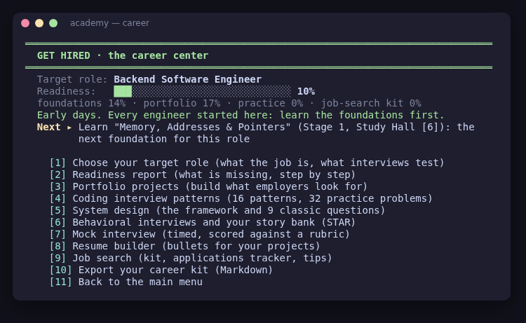

## Menu

**The home screen is simple by default.** It shows three numbers (your streak, today's study minutes, and the cards due), the stage you are working on, one call to action (today's workout, then your best next step) and a short menu of the things you do most days:

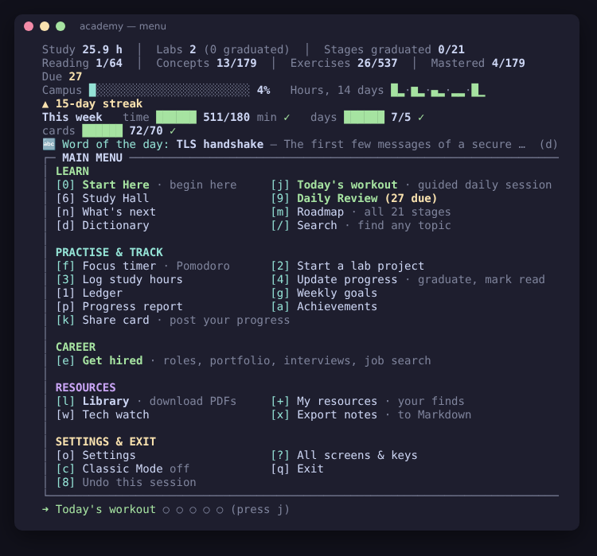

**`?` shows every screen**, grouped into the four sections below, followed by every key; type any key on that page to go straight there. Every key works from the home screen too, whether or not it is listed. If you prefer to see everything at once, **Settings** (`o`) → *Home screen: detailed* brings back the full dashboard (study hours, labs, stages, books read, concepts, exercises, mastery, campus progress, the 14-day activity line, weekly goals and the word of the day) and the full menu. Those numbers are always in the Progress report (`p`), under *At a glance*.

Keys never change, whatever the layout: wide terminals show two or three columns with hints, and narrow ones show two compact columns.

**Learn**

| Key | Action |
|---|--------|
| 0 | **Start Here**: what the academy covers, how memory works, how to practise, where to begin and a study rhythm |
| j | **Today's workout**: the guided daily session (review, blank-page recall, one new idea, mixed practice, reflect) |
| 6 | **Study Hall**: concepts, exercise gym, glossary, resources, lab blueprints, quiz and mastery check |
| 9 | **Daily Review**: your due spaced-repetition cards, interleaved across stages (`r` works too) |
| n | **What's next**: up to four recommended steps (due reviews, next concept, an open exercise, a ready mastery check or type-in, a focus session) and one key to start any of them |
| m | **Roadmap**: all 21 stages by track, each marked locked · ready · in progress · understood · mastered, with concept progress, "you are here", and which stages a locked one still needs; open any stage's Study Hall from it |
| d | **Programmer's dictionary**: 320+ jargon words explained plainly (see below) |
| / | **Search** (also `s`): every concept, glossary term, resource, blueprint and classic; all words must match, titles rank first; open a hit directly |
| e | **Get hired**: the career center (target roles, readiness, portfolio, coding and system design interviews, story bank, mock interviews, resume, job search; see above) |

**Practise & track**

| Key | Action |
|---|--------|
| f | **Focus timer**: a live countdown (`p` pause, `s` stop, bell when done) logged as a study session under a stage |
| 2 | **Start a lab project**: pick a track (`F`/`A`/`S`/`B`), a stage, then a name, notes and initial hours |
| 3 | **Log study hours**: add hours (`1.5`, `1h30m`, `45m`) with an optional note |
| 4 | **Update progress**: graduate stages or labs, mark literature as read, set compilation status |
| 1 | **Ledger**: a colour card per stage, with reading, concept and exercise progress bars, labs and hours |
| g | **Weekly goals**: study minutes, study days and review cards per week (Monday to Sunday), tracked on the dashboard: cyan on track, yellow behind, green done |
| p | **Progress report**: a GitHub-style activity calendar, the last 7 days against the 7 before, time and mastery per track, deck health and your most-forgotten cards |
| a | **Achievements**: 36 milestones (first concept, 7- and 30-day streaks, 100 and 1,000 reviews, a mastered concept, a passed mastery check, a whole track, graduation, and career ones: a first mock interview, six stories, a shipped portfolio project, ready to apply, a first application, an offer…), announced the moment you earn them |

**Resources**

| Key | Action |
|---|--------|
| k | **Share card**: your progress on one card, ready to screenshot and post (also `academy -card`) |
| l | **Library**: download free books and papers as PDFs without leaving the academy, then open them in your PDF viewer (see below) |
| + | **My resources**: add, edit, import and export your own books, courses, videos and sites |
| w | **Tech watch**: a method for keeping up, live headlines from 19 curated feeds, a watch log and your tech radar (see below) |
| x | **Export notes**: writes `academy_notes.md` next to the registry with your progress, own-words explanations, notebook and labs |

**Save & settings**

| Key | Action |
|---|--------|
| o | **Settings**: colour theme (default, high contrast, colour-blind friendly, monochrome), plain symbols instead of emoji, confidence ratings, Classic Mode, tidy screen, simple or detailed home screen |
| q | **Exit** (also `5`, `quit` or `exit`). Your progress is saved automatically after every action, so closing the window is fine too |
| 8 | **Undo this session**: puts your progress back exactly as it was when you opened the academy, then exits (asks first) |
| c | **Classic Mode** on/off: struggle clock, lab notebook, classic corners and type-ins |
| t | **Tidy screen** on/off: every action starts on a clean screen, so the scrollback stays readable (on by default for new learners) |
| ? | **All screens & keys** (also `h` or `help`): every screen, grouped, then every key; type a key on that page to go there · `clear` / `cls` clears the screen |

Above the menu, a dashboard shows hours, labs, stages, texts, concepts, exercises, **mastered concepts** and **cards due for review**, plus mastery-weighted campus progress, a 14-day activity sparkline, and a study streak (logged hours, focus sessions and review days all count). If you have set weekly goals, a **This week** line tracks them. Below it, a **➜ Next** line names your best next step; press `n` to start it.

Long screens (the ledger, Start Here, glossaries, resources, concept cards, the dictionary, the notebook) open full screen, like `man`. The text fills the terminal and only a status line sits at the bottom: the page's name when it fits, where you are (`lines 24–46 of 129`, `(END)`) and the keys that work there. Keys act at once, without Enter. **Space** next page, **Enter** or **↓** one line, **b** back a page, **g** / **G** the start / the end, **/word** find a word (every match is highlighted; **n** and **N** go to the next and previous match), **h** every key, **q** leave. When you leave, the normal screen comes back, with the part you were reading in view for the question that follows. Typing a number or a menu key leaves and answers whatever comes next, so you never have to page to the end of a list to pick from it.

Pages you open from the main menu (Start Here, All screens & keys, the ledger, the progress report, achievements) take the menu's keys: press `d` there and the Dictionary opens at once. Read them with Space, the arrows, PgUp/PgDn and `q`.

Leave a concept card before the end and the academy does not ask whether you understand it: it shows the key idea and how far you read, and offers to read the rest from where you stopped, to mark it understood, or to come back later.

Full-screen paging needs a terminal that delivers single keys: Linux, macOS and the BSDs. On Windows, and with `ACADEMY_PAGER=inline`, long screens are paged in the normal scrollback: the text stops after each page with no prompt under it, and **Enter** shows the next page. The same keys still work there if you type them and press Enter (`b`, `<`, `>`, `/word`, `q`, or a number or menu key to answer what comes next). Paging switches on only when you are typing at a real terminal; piped or scripted input is unaffected.

To cancel a prompt, type `q` at number prompts or `:q` at text prompts. Ctrl-D, Ctrl-C and closing the window (SIGTERM, SIGHUP) save before exiting.

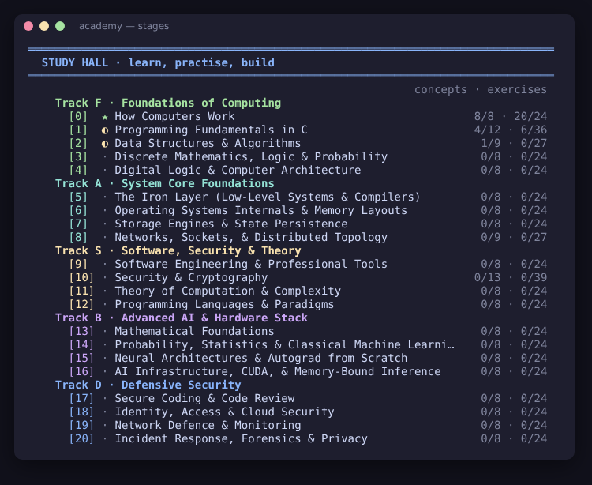


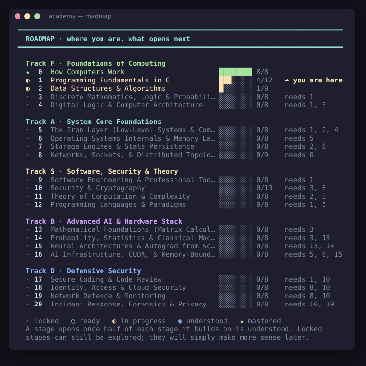

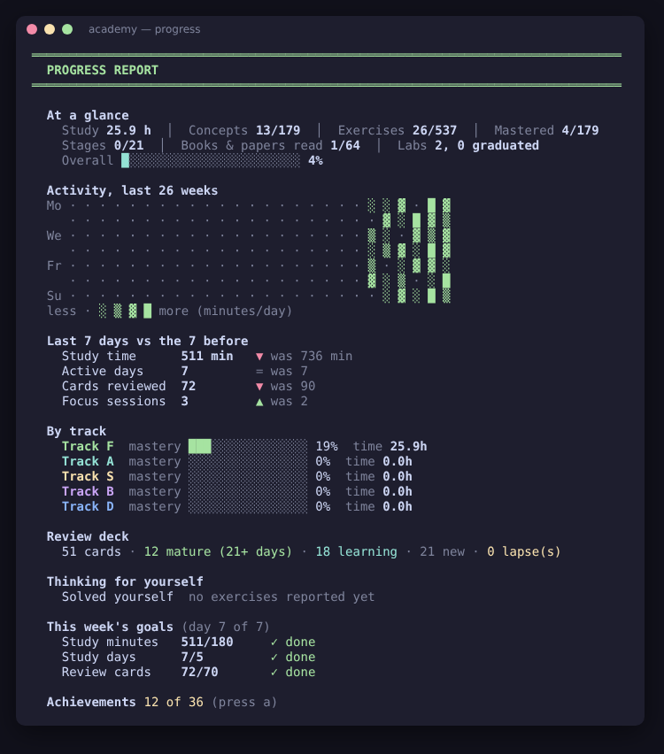

## Study Hall

For every stage:

- **Builds on:** the stages this one depends on, with a nudge if they are still thin.
- **What you'll be able to do:** concrete outcomes, shown before you begin.
- **Mastery overview:** a glyph per concept on the mastery ladder, and your mastery-check result.
- **Concepts:** the six-part cards described above. Each card starts with what it **builds on**: the earlier concepts it needs, ticked when you have marked them as understood. Mark each one as understood once you could explain it to a friend.
- **Exercise gym:** warm-up → practice → real-world, with hints and check-off.
- **Glossary:** 8–15 words explained simply.
- **Resource library:** free courses, books, papers, videos and tools with links, such as CS50, MIT OCW courses, OSTEP, CMU 15-445, PortSwigger Academy, ISL, and Karpathy's *Zero to Hero*.
- **Lab blueprints:** larger projects with milestones (a text adventure, a route planner, a CPU emulator, a password manager, a regex engine, Raft, GPT from scratch…). You can enroll any of them as a lab in one step.
- **Self-check quiz:** flashcards with self-scoring.
- **Mastery check:** a 12-question interleaved exam, passed at 80%.
- **Classic corner:** anchor book, classic text, real source code, the type-in lab and your lab notebook.
- **PDF library:** this stage's downloadable books and papers (the same as the main Library, filtered).
- **Checked exercises** (Stages 1, 5, 6 and 8): C programs you write and the academy compiles and tests for real (see [Checked exercises](#checked-exercises-your-c-compiled-and-tested-for-real)).

Concepts link across stages. For example, logic gates (Stage 4) become the CPU; the memory hierarchy (Stage 5) returns as the roofline model (Stage 16); and paging (Stage 6) returns as PagedAttention.

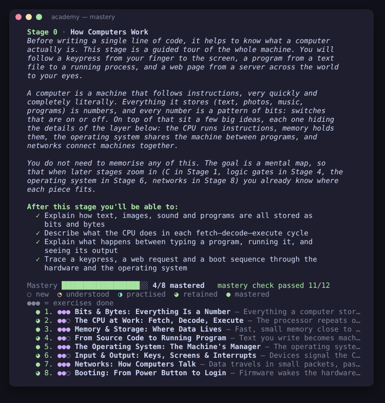

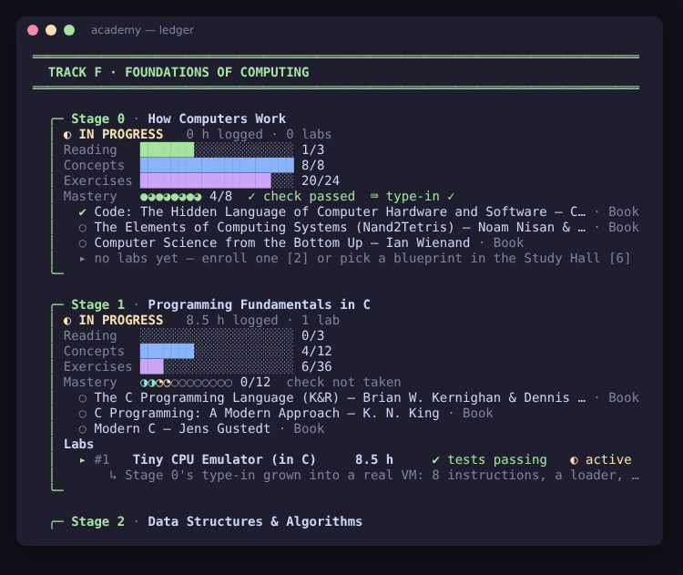

## Programmer's dictionary

Press **`d`**. Programmers use hundreds of words without explaining them, and every one is a chance to get lost. The dictionary explains 320+ of them in 12 categories: basics, types & data, functions & structure, memory & C, tools & workflow, systems & concurrency, networks & web, data & databases, algorithms, security, AI & ML, and programmer culture. Each entry has:

- **What it means**, in plain words;
- **Think of it like**: an everyday comparison;
- **In code**: a real example, in Python or, for memory and machine topics, in C;
- **⚠ Watch out**: the usual confusion or mistake;
- **Related** words you can jump to by number.

The words that matter most in systems, security and AI (pointer, stack and heap, virtual memory, system calls, threads, race conditions, deadlock, hash tables, Big-O, TCP, encryption and hashing, injection, buffer overflows, compilers, transactions, gradient descent, embeddings, models and more) also have a **Go deeper** section: a few paragraphs on how the thing actually works underneath, the trade-offs and the classic failure modes, so you can reason about it rather than just recognise the word. The deeper words cover what you meet in real engineering work: page faults, the TLB, copy-on-write, write-ahead logs, LSM trees, consensus and quorums, the CAP theorem, Lamport clocks, attention and transformers, the KV cache, quantization, side channels, tail latency, SLOs and more.

For example, *type casting* explains explicit and implicit conversion, shows `int("42")`, `(int)3.99` and why `"3" + 3` fails in Python but gives `"33"` in JavaScript, and warns that casting a float truncates instead of rounding.

Type any word, alias or part of one (`cast`, `segfault`, `GC`), browse by category or A–Z, or open the word of the day (also shown on the dashboard). Press **`r`** on a word to add it to your review deck; it then comes up in the Daily Review with spaced repetition. Every concept card has a **🔤 Programmer words here** box listing the jargon it uses, and search (`/`) covers the dictionary too.

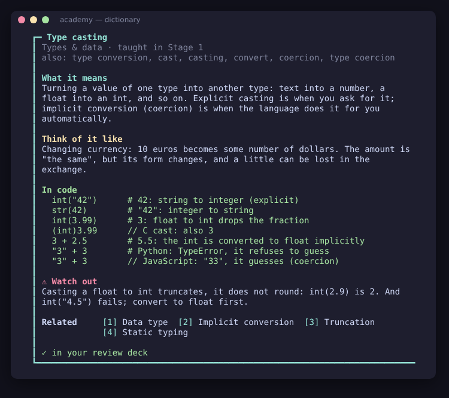

## Library: PDFs without leaving the academy

Press **`l`** on the main menu (or open a stage's **PDF library** in the Study Hall). The Library lists every free, legally hosted PDF in the curriculum, by stage:

- **Whole textbooks whose authors publish the PDF:** *Beej's Guide to C Programming*, Jeff Erickson's *Algorithms*, *Mathematics for Computer Science* (MIT), *Beej's Guide to Network Programming*, *Mathematics for Machine Learning*, *Linear Algebra Done Right* (4th ed., open access), *Think Stats*, *Crypto 101* and NIST's security guides.
- **Papers:** arXiv papers (the `arxiv.org/abs/…` page becomes its PDF), such as *Attention Is All You Need*, FlashAttention and PagedAttention.
- **Classic texts:** Dijkstra, Thompson, Ritchie & Thompson, Codd, Saltzer–Reed–Clark, Brooks, Turing, and more.

Choose a number to download it, with a live progress bar. **Ctrl+C** cancels a download without leaving the app, and a download stops by itself if the server sends nothing for 30 seconds. Then open it in your system PDF viewer (`xdg-open`, `open` or the Windows default app) while the academy keeps running. A saved document can be opened, downloaded again or deleted. **`a`** downloads every document you don't have yet in one go, so the whole library is on your disk even if a link breaks later. **`u`** saves a PDF from any https link you give it (an arXiv `abs` link works too), and **`o`** opens the library folder. Resources and classic readings with a PDF are marked **⬇ PDF** throughout the Study Hall.

Downloads go in a folder you can find in your file manager, arranged by stage and named after the document:

```
Documents/Academy Library/
    Stage 01 - Programming Fundamentals in C/
        Beej's Guide to C Programming.pdf
    Stage 04 - Digital Logic & Computer Architecture/
        First Draft of a Report on the EDVAC.pdf
    My PDFs/                  PDFs you saved from your own links
```

The Library screen shows the full path, and **`o`** opens it. On Linux the Documents folder is the one your desktop names in `~/.config/user-dirs.dirs`. Set `ACADEMY_LIBRARY` to use another folder; with `ACADEMY_HOME` set, the Library is `$ACADEMY_HOME/Academy Library`. PDFs downloaded by versions before 1.3 (the flat `academy_library/` folder beside the registry) are moved into place and renamed the first time you open the Library. PDFs you copy into the folder yourself show up in the list as **Yours**.

To prepare for offline study (Classic Mode's "offline blocks"), run `./academy -fetch-library` once: it downloads everything not yet saved and reports anything that failed.

**Broken links don't take the books with them.** When a document's link is dead (the site is down, the file moved, or it returns an error page instead of a PDF), the academy asks the [Internet Archive's Wayback Machine](https://web.archive.org/) for its saved copy of that exact link and downloads that instead, saying so on screen. The academy doesn't ship the PDFs inside the app: most are copyrighted works that their authors let you download for free from their own sites, not redistribute, so the app fetches them from the author or from the public archive. Once downloaded, they are yours to keep. The weekly link check also confirms that the archive fallback still works.

Downloads are careful:
- only `https://` links, including every redirect;
- the file must start with the PDF signature `%PDF-`, whatever the server claims, so an HTML "this page moved" response is refused instead of saved;
- 200 MB limit;
- the file streams into a temporary file that is renamed into place only once it is complete, so an interrupted download never leaves a broken file (leftovers are cleaned up next time);
- `HTTPS_PROXY` and the other standard proxy settings are honoured.

The academy cannot show PDF pages inside a terminal, so it hands them to your PDF viewer. On a machine without one (a server over SSH), it prints the file's path instead.

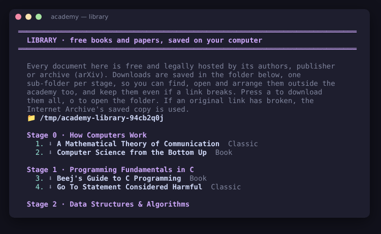

## Your own resources

Press **`+`** to add resources you found yourself: title, link, kind (book, course, video, article, paper, tool, site, podcast, newsletter), stage (or general), and a note on why it is good. They appear, marked ★:
- in that stage's **Resource library** (which also has **a** to add one on the spot);
- in **search** (`/`);
- in the **Library** (`l`) when the link is a PDF or an arXiv page, ready to download;
- in the **Markdown export** (`x`).

Share them: **e** writes `academy_resources.json` next to your registry, and **i** imports such a file from a friend, skipping duplicates and reporting anything invalid. The format is simple enough to write by hand:

```json
{
  "format": "academy-resources/1",
  "resources": [
    { "stage": 5, "kind": "Book", "title": "Modern C", "url": "https://…", "note": "Free, rigorous, up to date" }
  ]
}
```

`stage` is 0–16, or -1 for a general resource not tied to one stage.

### Adding resources to the curriculum itself

To ship a resource to every learner, add it to the stage's `Resources` in `curriculum*.go`, as `{Kind, Title, URL, Note}`. Use an official source over HTTPS, then run `go test ./...`, which checks that every link is HTTPS and every stage is complete, and `./academy -check-links` on a machine with internet access. A free, official PDF of a whole book goes in `freeBooks` in `library.go`, and a classic text in `classic.go`.

## Tech watch: keeping up with the field

Press **`w`**. Tech watch (*veille technologique*) is the habit of following what changes in your field deliberately, a little and often, and turning it into knowledge instead of noise.

- **How to keep up:** the method. It starts from fundamentals first: C, Unix, SQL and TCP/IP have lasted for decades (the Lindy effect), and deep knowledge of the layers underneath is what lets you judge any trend. It then describes a weekly 30–45 minute loop (skim → triage, save at most three → read one deeply → write why it matters → try one thing), a monthly radar review, how to choose sources, questions that cut through hype, and what to avoid.
- **Latest headlines:** fetched live (RSS 2.0, RSS 1.0 and Atom, parsed with Go's standard library) from 19 curated, high-signal feeds in 8 topics: arXiv (machine learning, operating systems, security), LWN, kernel.org releases, Brendan Gregg, Julia Evans, Dan Luu, the Go and Rust blogs, PostgreSQL news, Krebs on Security, Schneier on Security, Hugging Face, Simon Willison, Martin Fowler, Cloudflare, Hacker News and Lobsters. New items since your last visit are marked. Open an item to save it, open it in your browser, or download its PDF (arXiv papers) straight into the Library.
- **Watch log:** every saved item needs a line on *why it matters to you*, and moves from to read → read → tried (or dropped), with a note on what you learned.
- **My tech radar:** place items in Adopt, Trial, Assess or Hold, an idea popularised by Thoughtworks' Technology Radar.
- **Sources:** add any RSS or Atom feed of your own.

Feeds are fetched over HTTPS only, at most 5 MB each, six at a time with a 15-second timeout. Control characters and odd link schemes (such as `javascript:`) are removed, so a hostile feed cannot repaint your terminal or plant a bad link. Once you have some foundations (5 concepts understood), What's next suggests a weekly tech watch if you have not saved anything for 7 days.

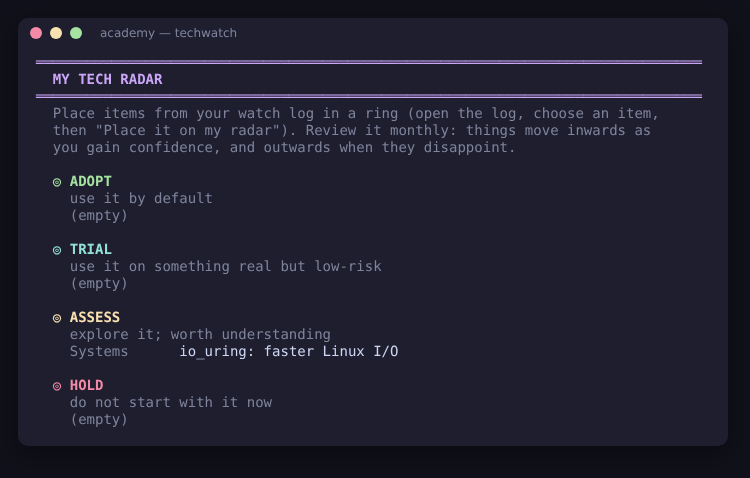

## Classic Mode: learn like it's 1985

Press **`c`** on the main menu. Classic Mode brings back the habits that made strong 1980s and 1990s learners so effective, and keeps modern help for when it is truly needed:

- **The struggle clock:** an exercise's hint stays locked for 10 min (warm-up), 30 min (practice) or 45 min (real-world) after you first open it. If you are truly stuck, you write down what you tried and where you are stuck, and the hint unlocks early. Describing the problem often solves it.
- **The lab notebook:** before an exercise you record a plan or prediction; afterwards, what actually happened. Entries are saved (`notebook`) and shown per exercise and per stage.
- **A classic corner in every Study Hall:**
  - **📕 Anchor book:** one book to read cover to cover, free wherever possible (HtDP, Erickson, Book of Proof, *Code*, CS:APP, OSTEP, DDIA, HPBN, Crafting Interpreters, MML, ISL…).
  - **📜 Classic text:** the field's history in the original, e.g. Dijkstra 1959 and 1968, von Neumann's EDVAC report (1945), Ritchie & Thompson's UNIX paper, Codd 1970, Thompson's *Trusting Trust*, Saltzer–Reed–Clark, Brooks's *No Silver Bullet*, *Smashing the Stack*, McCarthy's Lisp paper, Goldberg on floating point, LeNet (1998), and Wulf & McKee's *Memory Wall*.
  - **🔎 Read the source:** real, small codebases, such as Norvig's spelling corrector, algs4, Visual 6502, chibicc, xv6, SQLite, Redis's event loop, **Git's very first commit**, Juice Shop, Pike's regex matcher, lispy, micrograd and llm.c.
- **The type-in lab:** every stage has a short magazine-style listing, such as Collatz, the sieve, a ripple-carry adder built from gates, `fork(); fork();`, SQL injection, a regex matcher, a Lisp or a micro-autograd. You predict the output, type it in by hand (never paste), run it, then compare with the real output.

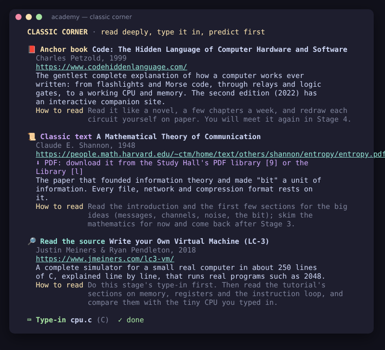

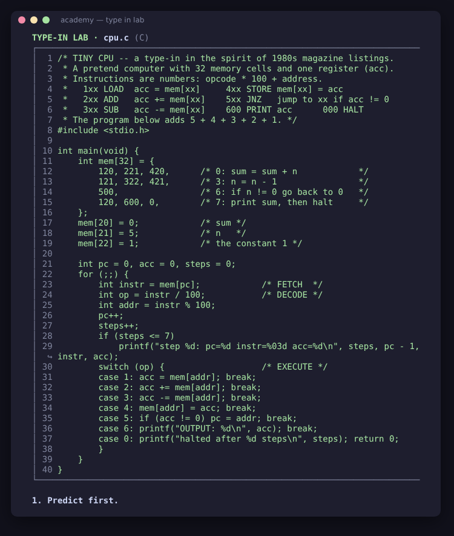

**Every type-in is tested:** the listings live in [`typeins/`](typeins/), and `typeins.go` is *generated* by running them (`python3 typeins/gen.py && gofmt -w typeins.go`). So the code on screen is exactly the code that was run, and every "expected output" is real output. Every classic-corner link was confirmed against live web search results.

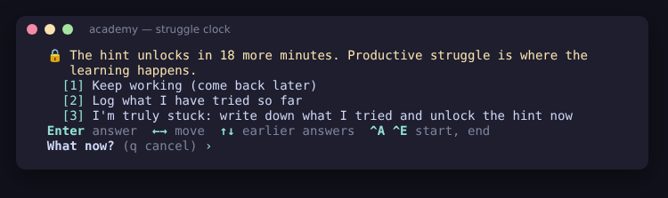

## Accurate resources

- **Verified links:** every resource link was reviewed on 2026-09-24. The less-established URLs were confirmed against live web search results. That review corrected several links: Book of Proof moved to the author's GitHub Pages site; MIT 6.1810 now points to its permanent OCW archive; OWASP now points to the 2025 edition; Drepper's paper, Hughes' paper and 3Blue1Brown now point to their canonical hosts; and two links became more precise deep links.
- **Go deeper:** every concept has a pointer to *exactly* where to continue in its stage's resources, such as "CS:APP chapter 6 (The Memory Hierarchy)", "Nand2Tetris project 3" or "OSTEP: the chapters on paging and TLBs". Pointers name chapters and lectures by title, not guessed page numbers.
- **Re-check any time:** links move, so run `./academy -check-links` on any machine with internet access. It checks every URL concurrently (HEAD, falling back to GET), and every Library PDF really is a PDF. Anything that fails is asked again a few seconds later, and it exits non-zero only for links that fail twice and need fixing (a 404, a moved page, a fake PDF). Sites that refuse automated checks (401, 403, 418, 429) or give no answer even after a retry (down, slow or blocked), or keep answering with a server error (5xx), are listed as warnings to look at, so a site being down for an hour never turns the check red.

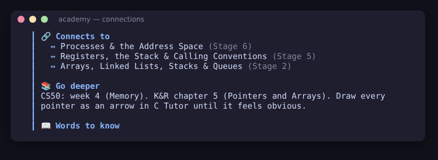

## Keyboard

| Key | Where | Does |
|-----|-------|------|
| **Ctrl+L** | any prompt | clears the screen and redraws it (the main menu is redrawn too), keeping what you have typed |
| Backspace | any prompt | deletes the previous character |
| Ctrl+U / Ctrl+W | any prompt | erases the whole line / the previous word |
| Ctrl+D | empty prompt | ends input: saves and exits |
| Ctrl+C | anywhere | saves and exits |
| Space / b | long screens | next page / previous page |
| Enter, ↓ / ↑ | long screens | one line down / up |
| g / G | long screens | the start / the end (also `<` / `>`, Home / End) |
| /word, n / N | long screens | find a word (highlighted), then the next / previous match |
| h / q | long screens | every pager key / leave |
| a number or key | long screens | leaves and answers the next prompt straight away: on a long list, type the item's number without paging to the end |

On Linux, macOS and the BSDs, the academy reads keys one at a time (a small built-in line editor using termios from Go's standard library), so Ctrl+L works instantly and arrow keys are ignored instead of printing `^[[A`. The terminal is always restored on exit, including after Ctrl+C. Elsewhere (for example Windows), input stays line-based: press **Ctrl+L then Enter**, or type `clear`.

## Resizing the terminal

The layout follows your terminal's **live size**. It reads the size with an ioctl on Linux, macOS and the BSDs, and asks the console on Windows, falling back to `$COLUMNS`/`$LINES`.

- **At the main menu the screen redraws itself as soon as you resize.** It keeps anything you have half-typed, and a whole burst of resize events while you drag a window edge produces a single redraw. Every other screen fits the new size the next time it is drawn, or immediately when you press **Ctrl+L**.
- **Layouts adapt from 40 columns up:**
  - The menu switches between two columns and one, and drops hints first.
  - Dashboard stats flow onto more lines.
  - Stage cards shrink their bars.
  - Lab rows split into two lines.
  - Long titles are cut with `…`, and paths and URLs wrap.
  - Long questions wrap, with your input on the last line.
  - Pages use the real terminal height.
- **Content stays readable:** it stops widening at 110 columns.
- **Code and diagrams:** code listings wrap long lines with a `↪` marker, so no code is ever hidden. ASCII diagrams are clipped with `…` and a note to widen the window.
- **Input that wraps across rows** is still erased and redrawn correctly by Backspace, Ctrl+U and Ctrl+W.
- **Checking it:** `tools/layout_check.py` drives every major screen through a real pseudo-terminal at any widths you give it and reports lines wider than the terminal. It currently finds none from 40 to 200 columns.

## Colours and settings

Colour is turned on automatically when output goes to a terminal. It is turned off by `-no-color`, by setting `NO_COLOR`, by `TERM=dumb`, or when output is piped. Text follows the live terminal width (40–110 columns; `$COLUMNS` or 80 when it cannot be read).

**Settings** (`o`) choose a colour theme: *Default*, *High contrast* (bright text, no faint grey), *Colour-blind friendly* (blue and orange carry the meaning instead of green and red) or *Monochrome* (no colour, only bold and layout). *Plain symbols* replaces emoji with ordinary characters of the same width, for terminals or fonts that draw emoji badly (some Windows consoles). Settings are saved in your registry.

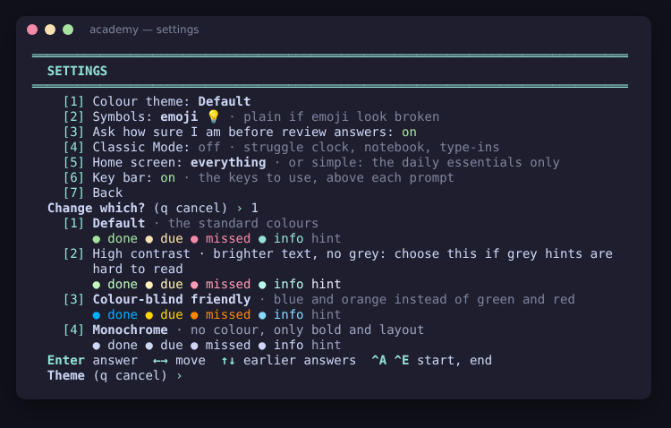

## Data safety

- **Atomic writes:** the program writes a temporary file in the same directory, fsyncs it, renames it over the registry, then fsyncs the directory. A crash leaves either the old file or the new one, never a half-written file.
- **Automatic saving:** your progress is written to disk after every action, and when you exit, press Ctrl+C or close the window. Nothing to remember, nothing to lose.
- **Automatic backups:** the first time something changes in a session, the registry as it was is copied to `academy_backups/` beside it, so the newest 10 backups cover your last 10 sessions (identical copies are skipped). `./academy -backups` lists them; `./academy -restore 2` (or `-restore path/to/file.json`) restores one after checking that it loads cleanly, and backs up the file it replaces first, so a restore can be undone the same way. Restore while the academy is closed.
- **Corrupt-file guard:** if the registry won't parse or fails validation, the program refuses to start rather than overwrite it.
- **Check log:** checked-exercise runs are appended to their own file, `academy_checks.jsonl`, never rewritten. So `academy -check` in another terminal cannot collide with the app saving your progress. A line torn by a crash is skipped when reading. Your C files are never overwritten.
- **Input rigor:** the program removes control characters, trims whitespace, and rejects input that is too long instead of cutting it off. It re-prompts when a number can't be parsed. Hours must be finite, non-negative, and at most 24 per log entry. Duplicate lab names within a stage are rejected, and so are unknown menu options.

## Schema (abridged)

```json
{
  "schema_version": 3,
  "last_commit": "2026-09-24T11:02:38Z",
  "next_lab_id": 2,
  "tracks": [{
    "id": "F", "name": "Foundations of Computing",
    "stages": [{
      "id": 2, "title": "Data Structures & Algorithms",
      "status": "Active Research",
      "required_literature": [{ "title": "The Algorithm Design Manual", "author": "Steven Skiena", "kind": "Book", "read": true }],
      "concepts_studied": ["Hash Tables"],
      "exercises_done": ["Hash Tables #1", "Hash Tables #3"],
      "notes": { "Hash Tables": "A hash turns the key into a bucket number, so we jump straight to it." },
      "mastery_check": { "taken_at": "2026-09-24T12:48:41Z", "score": 10, "total": 12, "passed": true },
      "labs": [{
        "id": 1, "name": "Route Planner",
        "architecture_notes": "Dijkstra and A* on an OpenStreetMap extract",
        "hours_logged": 4.75,
        "compilation_status": "Tests Passing",
        "status": "Mastered/Graduated",
        "enrolled_at": "2026-09-24T11:02:38Z",
        "hour_log": [{ "at": "2026-09-24T11:02:38Z", "hours": 1.5, "note": "initial hours" }]
      }]
    }]
  }],
  "reviews": {
    "Hash Tables :: key idea": { "due": "2026-09-27T00:00:00+02:00", "interval_days": 3, "ease": 2.5, "reps": 2, "lapses": 0, "last_reviewed": "2026-09-24T14:48:41+02:00" }
  },
  "review_history": { "2026-09-24": 4 },
  "goals": { "minutes": 150, "days": 5, "cards": 70 },
  "achievements": { "first-concept": "2026-09-24T11:05:00Z" },
  "word_deck": ["type casting", "pointer"],
  "my_resources": [{ "id": 1, "stage": 5, "kind": "Book", "title": "Modern C", "url": "https://…", "added": "2026-09-24T12:00:00Z" }],
  "feeds": [{ "title": "My favourite blog", "url": "https://…/atom.xml", "topic": "Systems" }],
  "watch": [{ "id": 1, "title": "…", "topic": "Systems", "why": "Stage 6 virtual memory in practice", "status": "read", "ring": "assess", "added": "2026-09-24T12:00:00Z" }],
  "study_sessions": [{ "start": "2026-09-24T14:00:00Z", "minutes": 25, "stage": 2, "note": "hash table exercise" }]
}
```

Review progress, notes and mastery checks are additive fields. Older files simply start with an empty deck.

Stage IDs run from 0 (How Computers Work) to 16. A resource or focus session not tied to a stage is stored with `"stage": -1`. Files from earlier versions are upgraded on load: schema 1 → 2 moved the original stages to their new numbers, and schema 2 → 3 added Stage 0 and moved "general" from 0 to -1.

## Tests

```sh
go test ./...
```

The tests check:
- **Curriculum integrity:** every seeded stage has a guide; every concept has an analogy, a real-life example and a warm-up → practice → real-world exercise ladder with hints; no orphaned explainer or exercise sets.
- **The v1 → v2 migration and stage merging.**
- **Retention:** the scheduler's intervals grow and reset on a lapse; deck unlocking and due cards; each step of the mastery ladder.
- **Classic Mode:** every stage has a complete classic corner with HTTPS links; the struggle clock's thresholds and early unlock; notebook and type-in progress survive a save round trip.
- **Checked exercises:** each check's reference solution passes every case, with gcc and with clang (70 checks, including a real loopback TCP server, forked processes and a write-ahead log the checker reads back). Mastery waits for a concept's check to pass. Typical mistakes fail with the right explanation:
  - the XOR swap;
  - `9 / 5` in integers;
  - an endless loop;
  - a NULL dereference;
  - the unfixed `fix_average` (an AddressSanitizer report with the line);
  - an error printed to stdout;
  - a warning;
  - a `main` where the checker supplies one.

  The tests also check that:
  - a forked child cannot outlive the time limit;
  - the program sees none of your environment variables;
  - checks still run where the sanitizers are missing;
  - starter files are never overwritten;
  - a torn log line is skipped.
- **Connections:** globally unique concept names; every concept has valid cross-links and a go-deeper pointer; stage and concept prerequisites only point backwards (so they cannot form a cycle), name real concepts, and agree with each other; every resource uses HTTPS.
- **Layout:** display widths (emoji, CJK and combining marks), wrap and flow never exceed the width, and long prompts wrap.
- **Guidance:** What's next ordering and its four-step limit, prerequisites, search AND semantics and ranking, snippets, daily minutes and the weekly comparison, focus sessions in stats, and the Markdown export.
- **Goals, roadmap and achievements:** the calendar week's minutes, days and cards; the on-track rule; each stage state and its missing prerequisites; achievements awarded exactly once; backups deduplicated, rotated to 10, restored, and bad backups refused without touching the registry.
- **Stage 0 and schema 3:** every stage from 0 to 16 is seeded and has a guide, Stage 1 requires Stage 0, and a schema-2 file gains Stage 0 while "general" resources and sessions move from 0 to -1; old registries have titles refreshed and missing reading added, without losing anything already read.
- **Dictionary:** 200+ complete entries in known categories, globally unique names and aliases, every "related" link resolves, lookup by alias, search ranking, detection in prose (skipping everyday words), a stable word of the day, and word review cards.
- **My resources:** validation (titles, stages, kinds, http(s) links only, no control characters), duplicate detection, search hits, Library PDFs, export, and import of both file formats with problems reported.
- **Tech watch:** parsing RSS 2.0, RSS 1.0 and Atom (CDATA, HTML entities, links only in a GUID, Latin-1 feeds, HTML titles, hostile control characters and `javascript:` links), fetching from a local HTTPS server (including 404s and plain `http`), per-feed limits and newest-first merging, watch-log and feed validation, the radar, and the weekly suggestion.
- **Library:** PDF address detection (including arXiv), a catalogue of unique, HTTPS, stage-filed documents, and downloads against a local HTTPS server: success with progress reporting, and refusal of non-PDF responses, HTTP errors, redirects to plain `http`, and oversized files, never leaving a partial file behind.
- **Mechanics:** text wrapping, hour parsing, the atomic-write round trip and the activity streak.

## Source layout

One package, one build target:

| File | Contents |
|------|----------|
| `main.go` | schema, migration, storage layer (atomic write), entry point |
| `console.go` | sanitised, line-based input over `bufio` |
| `ui.go` | ANSI styling, progress bars, text wrapping, sparklines |
| `app.go` | dashboard, ledger and all ledger actions |
| `studyhall.go` | concept reader, exercise gym, glossary, resources, blueprints, quizzes, Start Here |
| `retention.go` | review cards, SM-2 style scheduler, mastery ladder |
| `review.go` | Daily Review and Mastery Check screens |
| `connections.go` | concept cross-links, go-deeper pointers, stage prerequisites |
| `prereqs.go` | concept prerequisites, and the next concept to learn with them first |
| `linkcheck.go` | `-check-links` resource verifier |
| `lineedit.go` | key-by-key line editor: Ctrl+L, Backspace, Ctrl+U/W, ignores escape sequences |
| `term_*.go` | raw terminal mode via termios (Linux, macOS, BSD) and a line-mode fallback |
| `pagerfull.go` | the full-screen pager, like man and less (single keys, status line, search) |
| `pager.go` | the line pager used where single keys are unavailable, and pager search |
| `careers.go` | the career center: target roles, readiness, the job-search kit, the career export |
| `careers_coding.go`, `careers_design.go` | coding interview patterns and problems; system design, behavioral, resume and job-search content |
| `careerui.go` | career center screens: roles, readiness, portfolio, practice, mocks, story bank, resume, job search |
| `termsize_*.go`, `sigwinch_*.go` | live terminal size (ioctl / Windows console API) and resize notifications |
| `tools/layout_check.py` | overflow checker: renders every screen at chosen widths in a pseudo-terminal |
| `classic.go` | Classic Mode: classic corners, struggle clock, notebook |
| `classicui.go` | Classic Mode screens: toggle, classic corner, type-in lab, notebook |
| `insights.go` | What's next, search, study sessions, activity history, Markdown export |
| `insightsui.go` | screens for the above, including the live focus timer and progress report |
| `goals.go` | weekly goals, roadmap stage states, achievements, rotating backups and restore |
| `goalsui.go` | goals, roadmap and achievements screens |
| `library.go` | PDF catalogue, safe HTTPS downloader, system viewer, `-fetch-library` |
| `checks.go` | checked exercises: tasks, test cases, hints, harnesses |
| `checks_core.go` | checked exercises for Stages 2, 7 and 17: lists, hash maps, heaps, graphs, durable files, a write-ahead log, safe paths and strings |
| `checks_systems.go` | checked exercises for Stages 5, 6 and 8: bits, a parser, processes, system calls, threads, sockets, HTTP |
| `checks_foundations.go` | checked exercises added when Stages 2 to 8 were deepened, from Big-O and recursion to signals, Bloom filters and consistent hashing, with the generators of their big inputs |
| `checks_software.go` | checked exercises for Stages 9 to 12: Git's object IDs, build order, bisection, a regex engine, a Turing machine, a SAT solver, closures, reference counting and a bytecode VM |
| `runner.go`, `runner_*.go` | compile with the learner's C compiler, run each case with limits, explain failures |
| `checklog.go` | the labs folder, starter files, and the append-only log of runs and hints |
| `checksui.go` | checked-exercise screens and `-check` |
| `libraryui.go` | Library screen: download, open, re-download, delete, your own links |
| `vocab.go`, `vocab_*.go` | the programmer's dictionary and its entries |
| `vocabui.go` | dictionary screens, word of the day, word cards |
| `myresources.go`, `myresourcesui.go` | your own resources: storage, validation, import/export, screens |
| `techwatch.go` | curated feeds, RSS/Atom fetching and parsing, watch log, radar |
| `techwatchui.go` | tech-watch method, headlines, log, radar and sources screens |
| `assets/` | the icon (SVG, PNGs, .ico) and the social-preview image; `assets/logo/` holds the logo files and their usage guide |
| `rsrc_windows_*.syso` | the icon as Windows resources, generated by `tools/icons.py` |
| `typeins.go` | generated type-in listings with their real output (see `typeins/`) |
| `curriculum.go` | types, plus Tracks A and B (stages 5–8, 13, 15, 16) |
| `curriculum_machine.go` | Stage 0, How Computers Work |
| `curriculum_foundations.go` | Track F (stages 1–4) |
| `curriculum_software.go` | Track S (stages 9–12) |
| `curriculum_data.go` | Stage 14 |
| `explainers.go` | analogies, real-life examples and glossaries for the original stages; Start Here |
| `exercises.go` | exercises for the original stages |

## Releasing

For maintainers:

1. Update `CHANGELOG.md`, adding a `## [X.Y.Z] - YYYY-MM-DD` section.
2. Make sure CI is green on the commit you want to release.
3. Tag the commit and push the tag:

   ```sh
   git tag -a vX.Y.Z -m "vX.Y.Z"
   git push origin vX.Y.Z
   ```

The **Release** workflow (`.github/workflows/release.yml`) then:
- runs vet and the race-enabled tests;
- builds all seven targets with `tools/release.sh`, stamping the version into the binary;
- records a signed build-provenance attestation for every archive;
- publishes a GitHub release with the archives, `SHA256SUMS`, and that version's changelog section as the release notes. A tag with a hyphen, such as `v1.1.0-rc.1`, is published as a pre-release;
- runs `tools/packages.py`, which rewrites `Formula/academy.rb` (Homebrew) and `bucket/academy.json` (Scoop) at the repository root with the new download links and checksums, and commits them to the default branch. Pre-releases are skipped, and an older tag never replaces a newer version. If the branch rules refuse the workflow's push, it opens a pull request with the two files instead; merge it to update `brew` and `scoop`.

No terminal? Publish from the website instead: **Releases → Draft a new release**, type a new tag such as `v1.0.0`, paste the changelog section as the description, and click **Publish release**. The same workflow then builds the archives and attaches them to that release, usually within a few minutes.

Publishing from the website starts the workflow twice (once for the release, once for its new tag); the second run sees the files already attached and stops. To rebuild a release's files, delete its `SHA256SUMS` asset and re-run the workflow. The archives are reproducible: building the same commit again gives the same checksums.

To try the same build locally, run `tools/release.sh v0.0.0` and look in `dist/`.

Other tools in `tools/`:
- `layout_check.py`: renders every screen in a pseudo-terminal at chosen widths and reports overflowing lines.
- `packages.py`: writes the Homebrew formula and the Scoop manifest from a release's `SHA256SUMS`; the release workflow runs it for you.
- `monkey.py`: sends thousands of random keys and fails on any crash or hang.
- `screenshots.py`: regenerates `docs/*.png` from the real app, using a demo registry and headless Chromium.
- `demo_gif.py`: makes `docs/demo.gif`, the README tour, from the same real screens (needs Pillow as well).
- `icons.py`: regenerates every icon asset from `assets/icon.svg` and `assets/icon-small.svg` (the pin-less version used at 16–32 px), using headless Chromium:
  - PNGs from 16 to 1024 px;
  - `assets/academy.ico`;
  - `assets/social-preview.png`;
  - `rsrc_windows_amd64.syso` and `rsrc_windows_arm64.syso`, the Windows resources that give `academy.exe` its icon. Go's linker picks them up automatically, and only for Windows builds.

To use the social preview on GitHub, go to **Settings → General → Social preview**, click **Edit → Upload an image**, and choose `academy/assets/social-preview.png`.
